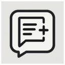
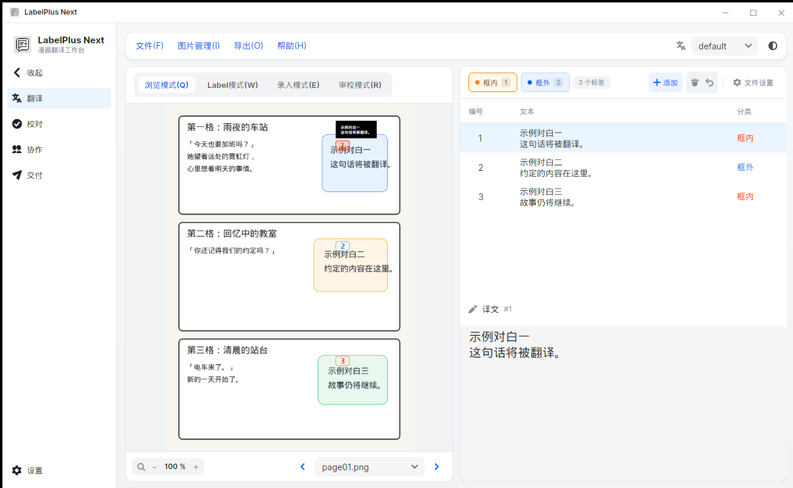
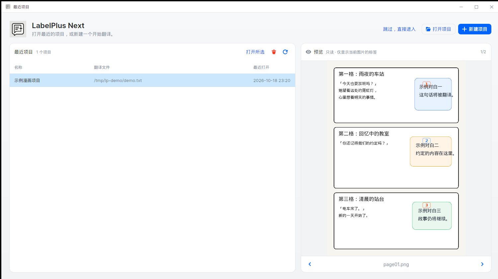
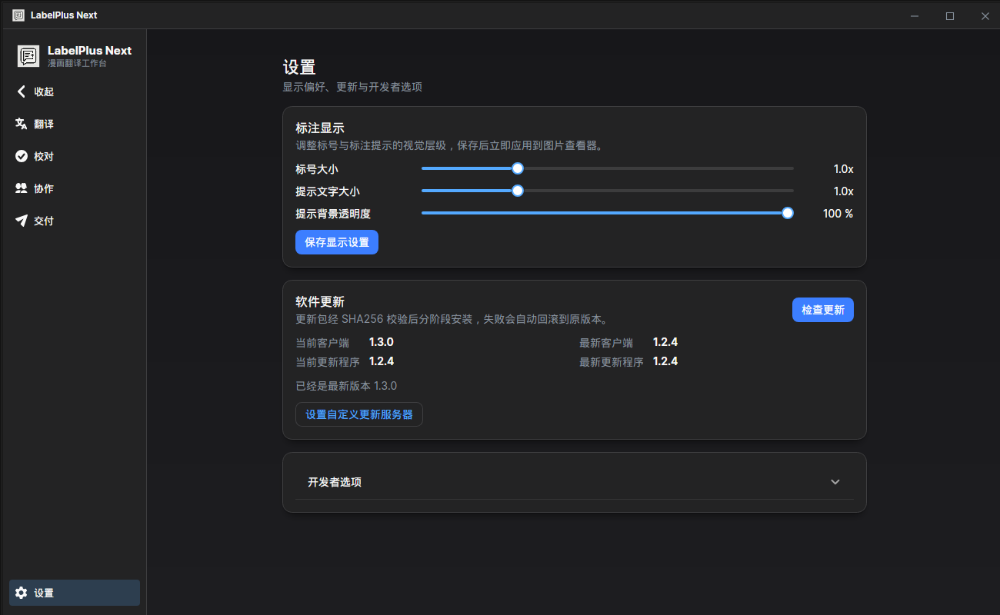
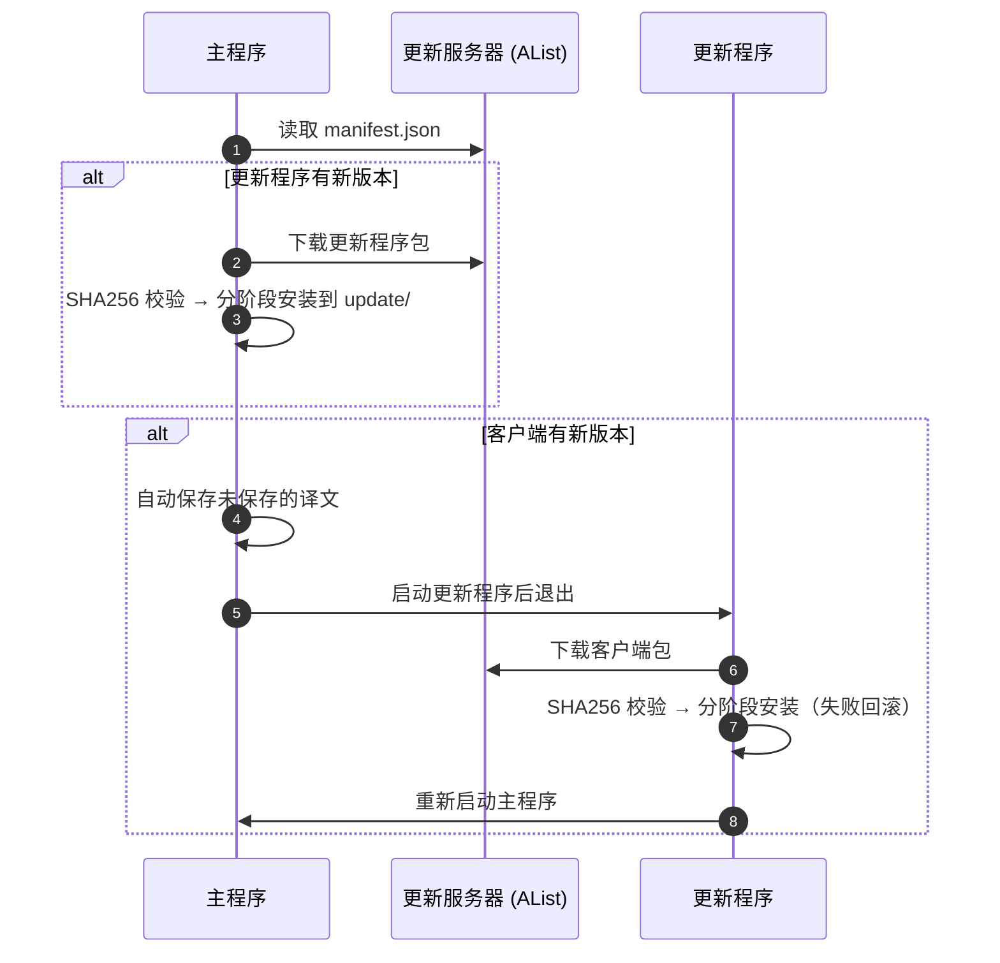

<div align="center">



# LabelPlus Next

**跨平台的漫画翻译工作台：标注、翻译、协作与安全发布**

[](https://github.com/SeaAndStars/LabelPlus_Next/releases)
[](https://github.com/SeaAndStars/LabelPlus_Next/actions/workflows/tests.yml)
[](https://dotnet.microsoft.com/download/dotnet/10.0)
[](https://avaloniaui.net/)
[](https://semi.design/)
[](#下载)
[](./LICENSE.md)

[**下载**](https://github.com/SeaAndStars/LabelPlus_Next/releases) ·
[文档站](https://doc.seastarss.cn) ·
[快速上手](https://doc.seastarss.cn/quickstart.html) ·
[常见问题](https://doc.seastarss.cn/faq.html)

<br />

<picture>
  <source media="(prefers-color-scheme: dark)" srcset="docs/images/translate-dark.png" />
  
</picture>

<sub>翻译工作区：左侧看图打点，右侧逐条录入译文。界面自动跟随系统浅色 / 深色主题。</sub>

</div>

> 技术栈：.NET 10 · Avalonia 12.1 · Semi Design（Semi.Avalonia 12）· Ursa 2.2 · CommunityToolkit.Mvvm

---

## ✨ 特性

<table>
<tr>
<td width="33%" valign="top">

### 🖼️ 看图即标注
内置 PicViewer：缩放、平移、左右键分类打点、拖拽微调。选中的标签直接在图上显示译文提示。

</td>
<td width="33%" valign="top">

### ⚡ 大图也流畅
图片在后台解码并预读下一页，翻页不卡界面；标注层复用画笔与文字排版，数百个标签也能流畅重绘。

</td>
<td width="33%" valign="top">

### 🎨 现代界面
全面采用 **Semi Design** 设计语言：统一的 4px 间距节奏、圆角与阴影层级，浅色 / 深色主题同步切换；按钮、数据表格与进度条均有平滑过渡，面板可拖动调整大小。

</td>
</tr>
<tr>
<td valign="top">

### 🤝 协作与同步
自动保存、远程同步、冲突检测与合并助手，多人翻译同一话也不怕覆盖。

</td>
<td valign="top">

### ☁️ 安全上传
流式直传，覆盖前自动备份旧版本并可回退；文件名自动解析“卷 / 番外 / 话数”生成规范目录。

</td>
<td valign="top">

### 🔄 可靠的自动更新
SHA256 强校验 + 分阶段安装，任一步失败自动回滚，下载中途可随时取消。

</td>
</tr>
</table>

## 📸 截图

<table>
<tr>
<td width="50%"></td>
<td width="50%"></td>
</tr>
<tr>
<td align="center"><sub>启动页：最近项目与只读预览</sub></td>
<td align="center"><sub>设置：标注显示与软件更新（深色主题）</sub></td>
</tr>
</table>

## 📥 下载

前往 [Releases](https://github.com/SeaAndStars/LabelPlus_Next/releases) 下载对应平台的压缩包，解压后运行即可：

| 平台 | 包名 | 启动 |
| --- | --- | --- |
| Windows x64 / arm64 | `LabelPlus_Next.Desktop-win-*.zip` | `LabelPlus_Next.Desktop.exe` |
| macOS Intel / Apple Silicon | `LabelPlus_Next.Desktop-osx-*.zip` | `./LabelPlus_Next.Desktop` |
| Linux x64 / arm64 | `LabelPlus_Next.Desktop-linux-*.zip` | `./LabelPlus_Next.Desktop` |

安装后程序会自动检查更新，无需重复下载。

## ⌨️ 快捷键

| 按键 | 作用 | 按键 | 作用 |
| --- | --- | --- | --- |
| <kbd>Q</kbd> | 浏览模式 | <kbd>Ctrl</kbd> + <kbd>S</kbd> | 保存 |
| <kbd>W</kbd> | Label 模式（打点） | <kbd>Ctrl</kbd> + <kbd>Shift</kbd> + <kbd>S</kbd> | 另存为 |
| <kbd>E</kbd> | 录入模式 | <kbd>Ctrl</kbd> + <kbd>O</kbd> / <kbd>N</kbd> | 打开 / 新建译文 |
| <kbd>R</kbd> | 审校模式 | <kbd>Ctrl</kbd> + <kbd>↑</kbd> <kbd>↓</kbd> | 上 / 下一个标签 |
| <kbd>1</kbd> / <kbd>2</kbd> | 所选标签设为框内 / 框外 | <kbd>Ctrl</kbd> + <kbd>←</kbd> <kbd>→</kbd> | 上 / 下一张图片 |
| | | <kbd>Ctrl</kbd> + <kbd>Z</kbd> | 撤销删除标签 |

## 🛠️ 从源码构建

需要 [.NET 10 SDK](https://dotnet.microsoft.com/download/dotnet/10.0)。

```bash
git clone https://github.com/SeaAndStars/LabelPlus_Next.git
cd LabelPlus_Next
dotnet run --project LabelPlus_Next.Desktop
```

发布单平台自包含版本：

```bash
dotnet publish LabelPlus_Next.Desktop -c Release -r win-x64 --self-contained
```

<details>
<summary><b>运行测试</b></summary>

```bash
# 仅本地测试（推荐）
dotnet test LabelPlus_Next.Test --filter "FullyQualifiedName!~Test1&FullyQualifiedName!~AuthApiTests"

# 全局异常处理测试仅在 Release 下有意义
dotnet test LabelPlus_Next.Test -c Release --filter "FullyQualifiedName!~Test1&FullyQualifiedName!~AuthApiTests"
```

> [!WARNING]
> `Test1` 与 `AuthApiTests` 中的集成测试会用 `LabelPlus_Next.Test/test.json` 的账号**真实访问并写入**远程存储，请只在自己的测试服务器上运行；CI 默认已跳过这两组测试。

</details>

<details>
<summary><b>项目结构</b></summary>

| 项目 | 说明 |
| --- | --- |
| `LabelPlus_Next` | 主程序 UI 与业务逻辑（视图、ViewModel、自定义控件、API 客户端） |
| `LabelPlus_Next.Desktop` | 桌面宿主（入口、平台清单、安装脚本） |
| `LabelPlus_Next.Update` | 独立更新程序：等待主程序退出后下载并安装客户端更新 |
| `LabelPlus_Next.Tools` | 发布工具：打包各平台产物、计算 SHA256、生成并上传更新清单 |
| `LabelPlus_Next.ApiServer` | 可选的自托管 API 服务（鉴权、文件系统），支持 Docker |
| `LabelPlus_Next.Test` | MSTest 单元测试与集成测试 |
| `Shared/UpdateKit.cs` | 客户端与更新程序共用的更新基础设施（链接编译进两个项目） |

</details>

## 🔄 自动更新是如何工作的



- **强校验**：清单提供 `sha256` 时，下载文件必须完全一致，否则重试 3 次后放弃，绝不安装。
- **分阶段安装**：先完整解压到安装目录内的临时目录，再逐个替换；文件被占用、磁盘已满、压缩包条目越界等任何错误都会把已替换的文件恢复原样。
- **语义化版本**：支持 `v1.2.3`、`1.3.0-beta.2` 等写法，`1.10.0` 正确地新于 `1.9.0`。

<details>
<summary><b>清单格式（manifest.json）</b></summary>

默认位置 `/OneDrive2/Update/manifest.json`，可在 **设置 → 软件更新 → 设置自定义更新服务器** 中修改。

```jsonc
{
  "schema": "v1",
  "projects": {
    "LabelPlus_Next.Desktop": {
      "latest": "1.3.0",
      "releases": [{
        "version": "1.3.0",
        "notes": "更新说明（显示在设置页）",
        "files": [{
          "name": "LabelPlus_Next.Desktop-win-x64.zip",
          "url": "https://…/d/…",
          "sha256": "…",
          "size": 0
        }]
      }]
    },
    "LabelPlus_Next.Update": { "latest": "1.3.0", "releases": [ /* 同上 */ ] }
  }
}
```

发布新版本时用 `LabelPlus_Next.Tools` 打包各平台产物，它会计算 SHA256 并更新、上传清单。

</details>

## 🙏 鸣谢

- **UI**：[Avalonia 12](https://avaloniaui.net/) · [Semi Design](https://semi.design/) · [Semi.Avalonia](https://github.com/irihitech/Semi.Avalonia) · [Ursa](https://github.com/irihitech/Ursa.Avalonia) · Avalonia DataGrid · Svg.Skia
- **库**：CommunityToolkit.Mvvm · ReactiveUI · Newtonsoft.Json · SharpCompress · RestSharp · WebDav.Client · Downloader · NLog · Antelcat.I18N

特别致谢 Ursa 及相关生态。

## 📄 许可协议

[MIT](./LICENSE.md) © SeaAndStars
